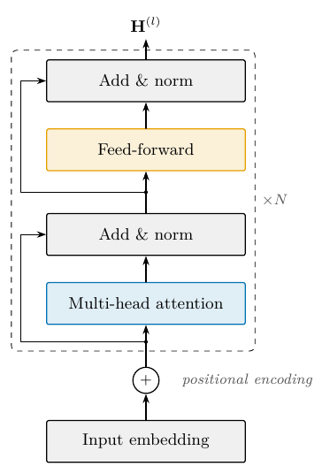
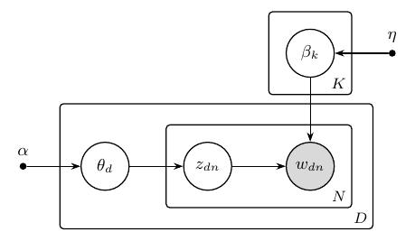
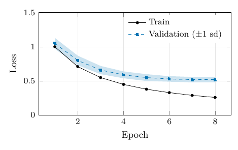
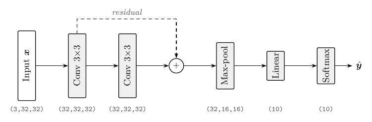
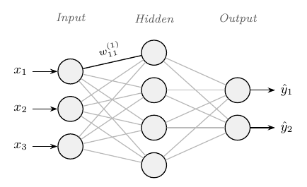
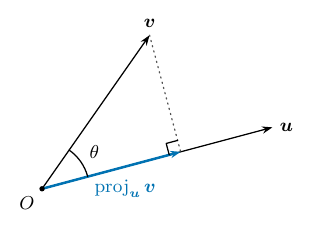
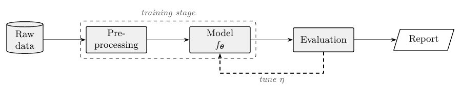
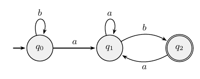
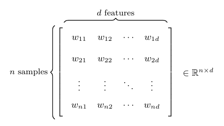

<div align="center">


**Keep your LaTeX paper honest to the code behind it.**

Verified citations · numbers that can't go stale · a build that fixes itself · publication-grade TikZ · arXiv-ready packages

[](LICENSE)


</div>

---

AgenTeX is a Claude Code plugin ([Agent Skills](https://docs.claude.com/en/docs/agents-and-tools/agent-skills/overview) plus hooks) for researchers whose results live in code and whose papers live in LaTeX.

Prose polishing is already well served by many tools. AgenTeX targets the problems where an agent with a shell, logs and APIs beats both chat assistants and editors, and it solves them with **deterministic tools that make the final call**, with the LLM organising the work and explaining the results.

## Why

- **Fabricated references survive peer review.** In 2025, "roughly one in twenty NeurIPS and USENIX Security papers contains at least two likely hallucinated" references (*Phantom References*, [arXiv:2607.00738](https://arxiv.org/abs/2607.00738)). 100 fabricated citations reached 53 accepted NeurIPS 2025 papers despite "review by 3-5 expert researchers per paper" ([arXiv:2602.05930](https://arxiv.org/abs/2602.05930)).
- **Numbers drift.** A rerun changes 87.3 to 86.9, but the abstract still says 87.3, and nobody remembers which script made `fig3.pdf`.
- **Compiling isn't correctness.** The vTikZ benchmark finds that current LLMs "struggle to reliably modify code in alignment with visual intent" ([arXiv:2505.04670](https://arxiv.org/abs/2505.04670)). Agents need to check the log *and* look at the result.

*(Each source was checked with AgenTeX's own `cite_verify.py`, and each quote against its abstract.)*

## Three guarantees

| | What you get | How |
|---|---|---|
| **1 · Citations are real** | Every cited entry is resolved against Crossref, arXiv, Semantic Scholar, OpenAlex and dblp, then classified as *verified*, *mismatch* ("Frankenstein" metadata), *bad-doi*, *not-found* (likely fabricated) or *published* (preprint has a published version). A **cite-guard hook** blocks the agent from adding any `\cite` whose entry isn't verified. | [`cite_verify.py`](skills/latex-references/scripts/cite_verify.py) + [`hooks/cite_guard.py`](hooks/cite_guard.py) |
| **2 · Numbers come from code** | Results JSON → `\res{exp.acc}` macros. An audit finds **stale** numbers (equal to a *previous* value of a result), hard-coded numbers and undefined keys. Generated booktabs tables. A provenance lock records the script, input hashes and commit behind every figure, and rebuilds stale ones. | [`results.py`](skills/latex-results-sync/scripts/results.py) |
| **3 · The build stays green** | After a turn that edited LaTeX, a **compile-loop hook** builds the paper. If there are errors or new undefined references or citations, it hands the agent a short digest to fix before you ever see the broken PDF (it gives up after 3 attempts). | [`hooks/compile_loop.py`](hooks/compile_loop.py) + [`texlog.py`](skills/latex-debug/scripts/texlog.py) |

Changes to references and numbers are never applied silently. Corrections are written as suggestions (`.agentex/suggested.bib`, audit replacements) for you to approve as a diff.

## Gallery

Tested TikZ patterns from [`latex-tikz`](skills/latex-tikz/SKILL.md), about 20 lines each on one shared style sheet. The agent copies the closest one, edits only what differs, then renders and *looks* at the result.

<table>
<tr>
<td align="center"><br><sub>Transformer block</sub></td>
<td align="center"><br><sub>Graphical model with plates</sub></td>
<td align="center"><br><sub>pgfplots with ±1 sd band</sub></td>
</tr>
<tr>
<td align="center"><br><sub>Network with tensor shapes</sub></td>
<td align="center"><br><sub>MLP from layer sizes</sub></td>
<td align="center"><br><sub>Exact geometric construction</sub></td>
</tr>
<tr>
<td align="center"><br><sub>Pipeline with feedback loop</sub></td>
<td align="center"><br><sub>State machine</sub></td>
<td align="center"><br><sub>Matrix with dimension braces</sub></td>
</tr>
</table>

## Skills

| | Skill | What it does |
|---|---|---|
| **Verify** | [`latex-references`](skills/latex-references/SKILL.md) | Citation verification against five databases, BibTeX from DOIs, natbib/biblatex setup, label/citation linter |
| | [`latex-results-sync`](skills/latex-results-sync/SKILL.md) | Results registry → macros, stale/hard-coded number audit, generated tables, figure provenance and rebuilds |
| | [`latex-consistency`](skills/latex-consistency/SKILL.md) | Paper ↔ code audit: equations vs implementation, hyperparameters vs configs, overclaims, leakage red flags |
| | [`latex-debug`](skills/latex-debug/SKILL.md) | Log digest (a 1,150-line log → 1 line), error lookup table, bisection workflow |
| **Write** | [`latex-project`](skills/latex-project/SKILL.md) | Paper/thesis scaffold next to your code; `texmap.py` project map so agents read only what they need |
| | [`latex-math`](skills/latex-math/SKILL.md) | Code → equations via a symbol map, with shape/index checks against the implementation and notation audits |
| | [`latex-tikz`](skills/latex-tikz/SKILL.md) | 12 tested patterns, shared styles, offline search of **1,229 official TikZ manual examples**, render-and-look loop |
| | [`latex-algorithms`](skills/latex-algorithms/SKILL.md) | Functions → `algorithmicx` pseudocode, or `minted`/`listings` pulled from source files |
| | [`latex-tables-figures`](skills/latex-tables-figures/SKILL.md) | booktabs/siunitx tables, matplotlib/pgfplots figures sized to the column |
| | [`latex-beamer`](skills/latex-beamer/SKILL.md) | Paper → timed talk with claim-style titles and reused figures and notation |
| **Review** | [`latex-research-check`](skills/latex-research-check/SKILL.md) | Closest prior work across OpenAlex/arXiv/Semantic Scholar, ranked by similarity to *your* abstract |
| | [`latex-plagiarism-check`](skills/latex-plagiarism-check/SKILL.md) | Sentence-level overlap with sources, with cited/quoted status (honest about what it can't do) |
| | [`latex-review`](skills/latex-review/SKILL.md) | Venue-style mock review, 3-reviewer panel + meta-review, anonymity checklist, rebuttal prep |
| **Ship** | [`latex-arxiv`](skills/latex-arxiv/SKILL.md) | Only the files the document uses, comments stripped, arXiv's 2025 bibliography rules (`.bbl` format 3.3), test-compiled |

## Install

**Claude Code plugin (skills + hooks), recommended:**

```text
/plugin marketplace add Metahemeralism/AgenTeX
/plugin install agentex@agentex
```

**Skills only** (no hooks): `cp -r AgenTeX/skills/* ~/.claude/skills/`. To get the guarantees without the plugin, copy the `hooks` block from [`hooks/hooks.json`](hooks/hooks.json) into your `settings.json`, replacing `${CLAUDE_PLUGIN_ROOT}` with your clone's path.

**Claude apps / other agents:** each skill is a folder with a `SKILL.md` in the open Agent Skills format. Zip one and upload it under *Settings → Capabilities → Skills*, or point any agent at it.

**Requirements:** Python 3.8+ (all scripts are standard library only), and TeX Live / MacTeX or [`tectonic`](https://tectonic-typesetting.github.io) for compiling. Optional: poppler (`pdftoppm`, `pdftotext`) for previews and PDF sources, and `S2_API_KEY` (free) for reliable preprint→published detection.

| Setting | Effect |
|---|---|
| `AGENTEX_CITE_GUARD=0` | turn off the cite guard |
| `AGENTEX_COMPILE_HOOK=0` | turn off the compile loop |
| `S2_API_KEY=…` | Semantic Scholar key (anonymous use is rate-limited) |
| `AGENTEX_MAILTO=you@uni.edu` | joins Crossref's polite pool |

Caches and state live in `.agentex/` in your project, which ignores itself in git.

## Use it

```text
> Check every citation in paper/ and show me what's wrong.
> I reran the experiments. What in the paper is now stale?
> Make results/main.csv into a table with the best numbers in bold.
> Draw the model in src/model.py as a TikZ figure with tensor shapes.
> Has anyone done this before? Find the closest work to my abstract.
> Review my paper as a NeurIPS reviewer.
> Package paper/ for arXiv.
```

### Scripts you can run yourself (or in CI)

| Script | Does |
|---|---|
| `latex-references/scripts/cite_verify.py paper/ [--suggest]` | Verify cited entries; exit 1 on fabricated, mismatched or duplicate entries |
| `latex-results-sync/scripts/results.py build\|audit\|table\|stale\|make` | Registry, stale-number audit, tables, provenance |
| `latex-references/scripts/check_refs.py paper/` | Undefined/duplicate labels, missing/uncited bib entries |
| `latex-debug/scripts/texlog.py main.log` | Log digest |
| `latex-project/scripts/texmap.py paper/` | Compact project map |
| `latex-tikz/scripts/tikzref.py brace decoration` | Offline TikZ manual search |
| `latex-tikz/scripts/tikzcheck.sh fig.tex` | Compile a figure; errors only + small PNG preview |
| `latex-research-check/scripts/related.py --from-tex main.tex` | Closest prior work |
| `latex-plagiarism-check/scripts/overlap.py paper/ sources/` | Overlap screening |
| `latex-arxiv/scripts/arxiv_pack.py main.tex --compile` | arXiv package, test-compiled |

## Built to be token-efficient

Lessons from auditing the [ponytail](https://github.com/DietrichGebert/ponytail) and [agent-skills](https://github.com/addyosmani/agent-skills) plugins, applied here:

| Technique | In AgenTeX | Effect (measured on this repo) |
|---|---|---|
| Short always-loaded descriptions | ~250 characters per skill | bodies load only when used |
| Deterministic scripts instead of reading | `texlog.py`, `cite_verify.py`, `results.py audit` | a 1,150-line compile log → 1 line |
| Compact project map | `texmap.py` | template project mapped in 663 characters |
| Local reference cache | `tikzref.py` over extracted manual examples | 248 characters returned vs a 624 KB manual page |
| Result caches | `.agentex/cite-cache.json` | re-verifying a bibliography goes from ~20 s to near-instant |
| Write styles once; copy and edit | `agentex-tikz.sty`, patterns, templates | output tokens spent only on what differs |
| Cheap visual checks | 100 dpi PNG previews | a few hundred image tokens per look |

## Honest limits

- **Citation checks** depend on public APIs. dblp currently puts scripted clients behind a bot check (AgenTeX skips it automatically), and Semantic Scholar rate-limits anonymous use. *not-found* means "no database knows it", so check by hand before calling it fabricated. Books, theses and software are reported as *unverifiable*, not *not-found*.
- **The results audit** reads LaTeX structure, not a regex over raw text, but it is still heuristic. It refuses to guess when a number matches more than 3 results.
- **Overlap screening** is not iThenticate: it only sees sources it can read, and AgenTeX offers no "AI-text detection", because such detectors are unreliable.
- **The compile loop** needs `latexmk` or `tectonic` and adds a build at the end of turns that edited LaTeX. Turn it off with `AGENTEX_COMPILE_HOOK=0`.

## Roadmap

From a ranked study of LaTeX bottlenecks for people who code:

- [ ] `/venue-convert` and `/camera-ready`: class/bibliography-style swaps, page-limit report, anonymous ↔ final mode
- [ ] Figure styling from `\columnwidth`: one matplotlib style file, detection of font-distorting `\includegraphics` rescales
- [ ] Notation-guardian subagent: a symbol table across all files, catching symbols with two meanings and drifting macros and acronyms
- [ ] `paper-ci`: pinned TeX build + GitHub Actions running cite/results audits and attaching a latexdiff
- [ ] `/rebuttal`: response letter mapped to the actual latexdiff/git changes
- [ ] Accessibility: tagged PDF (`\DocumentMetadata`), alt text drafted from the code and data behind each figure, veraPDF checks

## Repository layout

```
.claude-plugin/          plugin.json + marketplace.json
hooks/                   hooks.json, cite_guard.py, compile_loop.py (+ tests)
skills/
  latex-references/      cite_verify.py, check_refs.py
  latex-results-sync/    results.py
  latex-consistency/     latex-debug/ (texlog.py)   latex-project/ (templates, texmap.py)
  latex-math/            latex-tikz/ (assets, tikzref.py, tikzcheck.sh, manual index)
  latex-algorithms/      latex-tables-figures/       latex-beamer/ (talk template)
  latex-research-check/  latex-plagiarism-check/     latex-review/ (venue forms)
  latex-arxiv/           (arxiv_pack.py)
docs/gallery/            rendered pattern previews
docs/logo/               wordmark source (.tex) + PDF/SVG/PNG, card and transparent variants
```

## Contributing

Issues and PRs are welcome, especially roadmap items, venue review forms, and error→fix pairs for `latex-debug`.

- One skill = one folder with a `SKILL.md`. Its `description` decides when it triggers, so say *when to use it*, in under ~300 characters.
- Prefer a deterministic script to instructions wherever a check can be computed. Scripts are standard library only, each with tests:
  ```bash
  for d in hooks skills/*/scripts; do python3 -m unittest discover -s "$d" -q || exit 1; done
  ```
- New TikZ patterns must compile standalone with `agentex-tikz.sty`.

## License

[MIT](LICENSE), except `skills/latex-tikz/reference/tikz-manual.jsonl`. That file contains examples extracted from the [PGF/TikZ manual](https://tikz.dev) (© Till Tantau and the PGF/TikZ team) and is distributed under LPPL 1.3c. See [its notice](skills/latex-tikz/reference/NOTICE.md).
